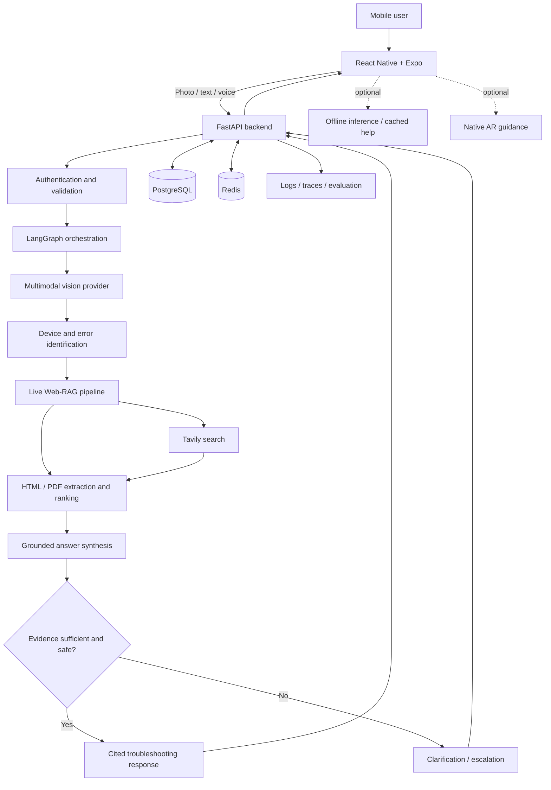

# SnapLens AI

**AI-powered visual troubleshooting assistant | Multimodal Vision · Live Web-RAG · Agentic AI**

> **Current milestone:** The public Gateway now runs a LangGraph workflow through Vision and Retrieval and returns a cited result or a clarification request. Mock providers are the default for no-cost local development. Tavily was live-verified once; keep it in mock mode until you deliberately want a search. Images are transient. Docker execution remains optional.

SnapLens AI is a cross-platform mobile application designed to turn a smartphone camera into an intelligent troubleshooting assistant. Users photograph equipment, appliances, electronics, or visible error codes; the system identifies relevant details, retrieves current technical information, and produces evidence-grounded, step-by-step guidance.

---

## Project Goals

- **Identify** device categories, brands, models, components, labels, and error codes from images.
- **Retrieve** relevant manufacturer manuals, support pages, and other technical references on demand.
- **Generate** cited troubleshooting guidance while communicating uncertainty and safety limitations.
- **Support** follow-up diagnostic conversations and optional hands-free voice interaction.
- **Explore** camera-based AR guidance and limited offline assistance on compatible devices.

---

## Planned Capabilities

| Capability | Description | Status |
| :--- | :--- | :--- |
| **Image-based device identification** | Multimodal analysis of photos and visible labels | Vision Service and Orchestrator flow implemented; live Gemini requires a key |
| **Live Web-RAG** | Search, extract, rank, and ground answers in retrieved sources | Tavily search, HTML/PDF extraction, source validation, and citations implemented |
| **Diagnostic orchestration** | Conditional workflows, clarification questions, and session state | LangGraph workflow implemented; mock and configurable Gemini answer providers |
| **Mobile client** | Cross-platform camera, question, answer, warning, and source interfaces | Expo app implemented in `mobile-app/`; device validation pending |
| **Voice assistance** | Speech input, transcription, and spoken responses | Planned |
| **AR guidance** | Visual annotations where device and platform support allow | Research / planned |
| **Offline fallback** | Limited on-device inference and cached guidance | Research / planned |
| **Observability and evaluation** | Quality, reliability, latency, and cost monitoring | Planned |

---

## System Architecture



> [!CAUTION]
> **Safety Boundary:** The system should not invent model numbers, fabricate citations, or provide speculative instructions for hazardous repairs. High-risk electrical, gas, mechanical, or pressurized work should be escalated appropriately.

---

## Technology Stack and Rationale

| Layer | Selected / Candidate Technology | Why |
| :--- | :--- | :--- |
| **Mobile** | React Native, Expo, TypeScript | Shared iOS/Android codebase and mobile tooling |
| **Camera** | expo-camera | Capture images and camera permissions |
| **Audio** | expo-audio | Modern Expo audio recording/playback APIs |
| **Backend** | Python, FastAPI, Pydantic | Typed APIs and Python AI ecosystem |
| **Vision** | Google Gemini multimodal API | Image and text understanding without training a custom vision model |
| **Agent orchestration** | LangGraph | Stateful, conditional, interruptible diagnostic workflows |
| **Web search** | Tavily | Search results for retrieval-oriented applications |
| **Extraction** | BeautifulSoup4 and PDF parsing tools | Clean HTML and retrieve text from technical manuals |
| **LLM synthesis** | Configurable Gemini / other compatible model | Evidence-grounded answer generation and provider flexibility |
| **Database** | PostgreSQL | Users, sessions, diagnostic history, and source metadata |
| **Cache / transient state** | Redis | Caching, rate limiting, and temporary state where needed |
| **Authentication** | To be finalized | Secure account and session access |
| **API / deployment** | Docker, reverse proxy, cloud hosting | Reproducible deployment and operations |
| **Evaluation** | pytest, integration tests, AI evaluation datasets | Detect regressions and measure groundedness |
| **Monitoring** | Structured logs, OpenTelemetry / tracing | Diagnose latency, failures, and provider costs |
| **AR** | Platform-native AR integration (to be validated) | Camera-space overlays and tracking |
| **Offline AI** | Quantized small model / on-device runtime (to be validated) | Limited assistance without network connectivity |

*Exact model versions, hosting providers, AR compatibility, and on-device runtimes will be pinned after feasibility and device testing.*

---

## End-to-End Workflow

1. **Capture:** The mobile app captures an image and optional question or voice input.
2. **Validate:** The backend checks image type, file signature, size, and request constraints.
3. **Understand:** A multimodal model extracts device identity, visible text, and potential error codes.
4. **Clarify:** If the identity is ambiguous, the user is asked to confirm the model or capture another image.
5. **Retrieve:** The search layer finds relevant official manuals, manufacturer pages, and other sources.
6. **Process:** Retrieved HTML/PDF content is extracted, filtered, ranked, and prepared as evidence.
7. **Reason:** The diagnostic workflow decides whether to search again, ask a question, or generate a response.
8. **Verify:** Generated steps are checked against available evidence and safety constraints.
9. **Respond:** The app displays steps, citations, warnings, and follow-up options.
10. **Persist:** Authorized session history, relevant metadata, and operational telemetry are stored according to retention rules.

---

## Development Phases

| Phase | Scope |
| :---: | :--- |
| **0** | Architecture decisions, repository, service contracts | Complete |
| **1** | Local FastAPI foundation and Gateway-to-Orchestrator path | Foundation complete; authentication, persistence, and media handling remain |
| **2** | Vision analysis, structured identification, OCR/error-code extraction | Provider service ready; live Gemini verification remains |
| **3** | Retrieval Service, Tavily, bounded results, HTML/PDF extraction | Complete; Tavily live-verified |
| **4** | LangGraph orchestration, Vision/Retrieval integration, cited answer | Complete in mock mode; source-backed Gemini answer verification remains |
| **5** | React Native mobile application and full backend integration | Implemented; Android/iOS device validation pending |
| **6** | Voice input/output and real-time interaction |
| **7** | AR overlays and compatible-device tracking |
| **8** | Offline inference and cached guidance |
| **9** | Security hardening, evaluation, deployment, observability, release |

---

## Repository Layout

```text
snaplens-ai/
├── services/              # Each folder is one independently runnable microservice
│   ├── api-gateway/       # Public API entry point
│   ├── diagnostic-orchestrator/ # Coordinates diagnosis steps
│   ├── vision-service/    # Image understanding
│   ├── retrieval-service/ # Search and source retrieval
│   └── session-service/   # Session and conversation history
├── shared/
│   └── contracts.py       # Request and response models used by services
├── mobile-app/            # Expo / React Native camera and diagnosis client
├── docs/                  # Architecture, ADRs, and API contracts
├── scripts/               # Local smoke checks
├── tests/                 # Backend contract and handler tests
├── docker-compose.yml     # Optional local container setup
├── .venv/                 # Local Python dependencies; created during setup and Git-ignored
├── .gitignore
└── README.md
```

The service folder name identifies each microservice; its `main.py` file is the FastAPI entry point. The Expo app lives in `mobile-app/` and never contains provider API keys.

---

## Local Development

### Prerequisites

- Windows 10/11 with PowerShell.
- Python 3.12 or newer and Node.js 22.13 or newer (`node --version`, `python --version`).
- Expo Go on an Android/iPhone for physical-device testing. Android Studio is optional if using an emulator.
- Docker is optional. Provider API keys are not needed for mock mode.

### One-time install

Run from the repository root (`D:\snaplens\snaplens-ai` in this checkout):

```powershell
python -m venv .venv
.\.venv\Scripts\python.exe -m pip install --upgrade pip
.\.venv\Scripts\python.exe -m pip install -r requirements.txt
if (!(Test-Path .env)) { Copy-Item .env.example .env }
Set-Location mobile-app
npm ci
if (!(Test-Path .env)) { Copy-Item .env.example .env }
Set-Location ..
```

The guarded copy commands preserve an existing local `.env` and its private
keys. Fresh installs use mock Vision, Retrieval, and Answer providers, so they
make no Gemini or Tavily requests. To use live providers, add credentials to
the ignored **repository-root** `.env` and deliberately change the matching
provider settings. Never put provider keys in `mobile-app/.env` or an
`EXPO_PUBLIC_*` value. See [environment-variable details](docs/environment-variables.md).

### Start all backend services

From the repository root, run:

```powershell
.\scripts\start-local.ps1
```

This opens a PowerShell window for each service that is not already using its
port, detects the PC's LAN address, and writes that address into
`mobile-app/.env` for a phone to reach the Gateway. Keep the service windows
open while testing. You can rerun the launcher; it skips occupied ports to
avoid duplicate-server “address already in use” errors. Confirm all four
health checks below return `status: ok`.

The services and local-only URLs are:

| Service | Port | Health check |
|---|---:|---|
| API Gateway | 8000 | `http://127.0.0.1:8000/health/ready` |
| Diagnostic Orchestrator | 8001 | `http://127.0.0.1:8001/health/ready` |
| Vision | 8002 | `http://127.0.0.1:8002/health/ready` |
| Retrieval | 8003 | `http://127.0.0.1:8003/health/ready` |

The Gateway's readiness check depends on the Orchestrator; the Orchestrator's
readiness check depends on Vision and Retrieval. If starting manually, start
Vision and Retrieval first, then Orchestrator, then Gateway. From separate
PowerShell windows at the repository root, use:

```powershell
.\scripts\run-local-service.ps1 -Service vision
.\scripts\run-local-service.ps1 -Service retrieval
.\scripts\run-local-service.ps1 -Service orchestrator
.\scripts\run-local-service.ps1 -Service gateway
```

Run one command per window. The launcher configures `PYTHONPATH` and internal
service addresses for you. Check readiness after startup:

```powershell
foreach ($port in 8002, 8003, 8001, 8000) {
  Invoke-RestMethod "http://127.0.0.1:$port/health/ready"
}
```

Stop a manually started service with **Ctrl+C** in its window. If a port is
already occupied, inspect its owner before stopping anything:

```powershell
Get-NetTCPConnection -State Listen -LocalPort 8000,8001,8002,8003 |
  Select-Object LocalAddress,LocalPort,OwningProcess
$ownerPid = (Get-NetTCPConnection -State Listen -LocalPort 8000 -ErrorAction Stop |
  Select-Object -First 1 -ExpandProperty OwningProcess)
Get-Process -Id $ownerPid
```

### Start the mobile app

Start the backend first, then use a new PowerShell window:

```powershell
Set-Location mobile-app
npm start -- --lan
```

Scan the new QR code with Expo Go. If `mobile-app/.env` was changed while Expo
was already running, stop Expo with **Ctrl+C** and restart it to load the new
URL. Use the address for the device type:

| Client | `EXPO_PUBLIC_API_BASE_URL` |
|---|---|
| Physical phone | `http://<PC-Wi-Fi-IPv4>:8000` |
| Android emulator | `http://10.0.2.2:8000` |
| iOS simulator | `http://127.0.0.1:8000` |

For a physical phone, the phone and PC must be on the same Wi-Fi. Windows
Firewall must allow inbound TCP port `8000` on the active network. The Gateway
listens on all interfaces; internal services stay on the PC. Do not use
`localhost` or the Metro port `8081` as the phone's Gateway address.

### Try a diagnosis

The mobile flow accepts JPEG, PNG, or WebP images up to 10 MiB. With default
mock providers, the API deliberately returns a clarification response instead
of claiming it analyzed the photo. For a real diagnosis, configure the server-
side Gemini key and providers; enable Tavily only when you want to spend search
credits. The sample JPEG for direct API checks is `scripts/sample.jpg`:

```powershell
curl.exe -X POST http://127.0.0.1:8000/v1/diagnoses `
  -F "question=What does this error code mean?" `
  -F "image=@scripts/sample.jpg"
```

### Run the backend service tests

From the repository root, run the offline service and contract suite:

```powershell
.\.venv\Scripts\python.exe -m unittest discover -s tests
```

The tests use local fakes for external providers, so they do not call Gemini or
Tavily and do not consume API credits. A successful run ends with `OK`.

Dockerfiles and `docker-compose.yml` are optional configuration for later
container-based development; the commands above run services directly on
Windows without Docker.

> [!IMPORTANT]
> **Environment & Secrets:** Never commit actual `.env` files, private credentials, uploaded user images, or sensitive logs. Each application will provide a sanitized `.env.example` listing required variables without values.

---

## Engineering Principles

- **Evidence-first answers** with traceable citations.
- **Explicit uncertainty** and user confirmation when identification is ambiguous.
- **Safety-aware diagnostic recommendations** and professional escalation for hazardous tasks.
- **Modular interfaces** between API, providers, retrieval, orchestration, and mobile UI.
- **Automated tests**, evaluation cases, observability, and documented architectural decisions.
- **Respect for source-site access restrictions**, copyright, privacy, and user consent.

---

## Documentation

The architecture blueprint and API contracts are documented in [`docs/`](docs/). Database schemas and operational runbooks will be added as those features are implemented.

- [Project roadmap and progress checklist](docs/PROJECT-ROADMAP.md)
- [Environment variables by service and phase](docs/environment-variables.md)

---

## Contributing and License

This repository is currently a personal development project. Contribution guidelines and licensing terms will be published separately. No open-source license has been granted by default.
