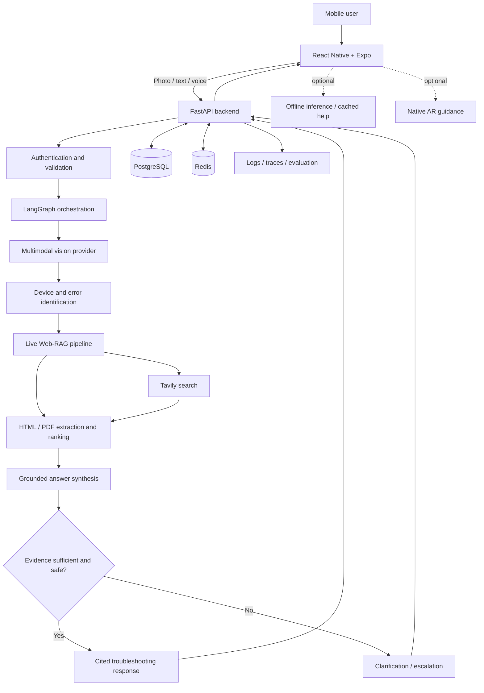

# SnapLens AI

**AI-powered visual troubleshooting assistant | Multimodal Vision · Live Web-RAG · Agentic AI**

> **Current milestone:** The public Gateway now runs a LangGraph workflow through Vision and Retrieval and returns a cited result or a clarification request. Mock providers are the default for no-cost local development. Tavily was live-verified once; keep it in mock mode until you deliberately want a search. Images are transient. Docker execution remains optional.

SnapLens AI is a cross-platform mobile application designed to turn a smartphone camera into an intelligent troubleshooting assistant. Users photograph equipment, appliances, electronics, or visible error codes; the system identifies relevant details, retrieves current technical information, and produces evidence-grounded, step-by-step guidance.

---

## Project Goals

- **Identify** device categories, brands, models, components, labels, and error codes from images.
- **Retrieve** relevant manufacturer manuals, support pages, and other technical references on demand.
- **Generate** cited troubleshooting guidance while communicating uncertainty and safety limitations.
- **Support** follow-up diagnostic conversations and optional hands-free voice interaction.
- **Explore** camera-based AR guidance and limited offline assistance on compatible devices.

---

## Planned Capabilities

| Capability | Description | Status |
| :--- | :--- | :--- |
| **Image-based device identification** | Multimodal analysis of photos and visible labels | Vision Service and Orchestrator flow implemented; live Gemini requires a key |
| **Live Web-RAG** | Search, extract, rank, and ground answers in retrieved sources | Tavily search, HTML/PDF extraction, source validation, and citations implemented |
| **Diagnostic orchestration** | Conditional workflows, clarification questions, and session state | LangGraph workflow implemented; mock and configurable Gemini answer providers |
| **Mobile client** | Cross-platform camera, question, answer, warning, and source interfaces | Expo app implemented in `mobile-app/`; device validation pending |
| **Voice assistance** | Speech input, transcription, and spoken responses | Planned |
| **AR guidance** | Visual annotations where device and platform support allow | Research / planned |
| **Offline fallback** | Limited on-device inference and cached guidance | Research / planned |
| **Observability and evaluation** | Quality, reliability, latency, and cost monitoring | Planned |

---

## System Architecture



> [!CAUTION]
> **Safety Boundary:** The system should not invent model numbers, fabricate citations, or provide speculative instructions for hazardous repairs. High-risk electrical, gas, mechanical, or pressurized work should be escalated appropriately.

---

## Technology Stack and Rationale

| Layer | Selected / Candidate Technology | Why |
| :--- | :--- | :--- |
| **Mobile** | React Native, Expo, TypeScript | Shared iOS/Android codebase and mobile tooling |
| **Camera** | expo-camera | Capture images and camera permissions |
| **Audio** | expo-audio | Modern Expo audio recording/playback APIs |
| **Backend** | Python, FastAPI, Pydantic | Typed APIs and Python AI ecosystem |
| **Vision** | Google Gemini multimodal API | Image and text understanding without training a custom vision model |
| **Agent orchestration** | LangGraph | Stateful, conditional, interruptible diagnostic workflows |
| **Web search** | Tavily | Search results for retrieval-oriented applications |
| **Extraction** | BeautifulSoup4 and PDF parsing tools | Clean HTML and retrieve text from technical manuals |
| **LLM synthesis** | Configurable Gemini / other compatible model | Evidence-grounded answer generation and provider flexibility |
| **Database** | PostgreSQL | Users, sessions, diagnostic history, and source metadata |
| **Cache / transient state** | Redis | Caching, rate limiting, and temporary state where needed |
| **Authentication** | To be finalized | Secure account and session access |
| **API / deployment** | Docker, reverse proxy, cloud hosting | Reproducible deployment and operations |
| **Evaluation** | pytest, integration tests, AI evaluation datasets | Detect regressions and measure groundedness |
| **Monitoring** | Structured logs, OpenTelemetry / tracing | Diagnose latency, failures, and provider costs |
| **AR** | Platform-native AR integration (to be validated) | Camera-space overlays and tracking |
| **Offline AI** | Quantized small model / on-device runtime (to be validated) | Limited assistance without network connectivity |

*Exact model versions, hosting providers, AR compatibility, and on-device runtimes will be pinned after feasibility and device testing.*

---

## End-to-End Workflow

1. **Capture:** The mobile app captures an image and optional question or voice input.
2. **Validate:** The backend checks image type, file signature, size, and request constraints.
3. **Understand:** A multimodal model extracts device identity, visible text, and potential error codes.
4. **Clarify:** If the identity is ambiguous, the user is asked to confirm the model or capture another image.
5. **Retrieve:** The search layer finds relevant official manuals, manufacturer pages, and other sources.
6. **Process:** Retrieved HTML/PDF content is extracted, filtered, ranked, and prepared as evidence.
7. **Reason:** The diagnostic workflow decides whether to search again, ask a question, or generate a response.
8. **Verify:** Generated steps are checked against available evidence and safety constraints.
9. **Respond:** The app displays steps, citations, warnings, and follow-up options.
10. **Persist:** Authorized session history, relevant metadata, and operational telemetry are stored according to retention rules.

---

## Development Phases

| Phase | Scope |
| :---: | :--- |
| **0** | Architecture decisions, repository, service contracts | Complete |
| **1** | Local FastAPI foundation and Gateway-to-Orchestrator path | Foundation complete; authentication, persistence, and media handling remain |
| **2** | Vision analysis, structured identification, OCR/error-code extraction | Provider service ready; live Gemini verification remains |
| **3** | Retrieval Service, Tavily, bounded results, HTML/PDF extraction | Complete; Tavily live-verified |
| **4** | LangGraph orchestration, Vision/Retrieval integration, cited answer | Complete in mock mode; source-backed Gemini answer verification remains |
| **5** | React Native mobile application and full backend integration | Implemented; Android/iOS device validation pending |
| **6** | Voice input/output and real-time interaction |
| **7** | AR overlays and compatible-device tracking |
| **8** | Offline inference and cached guidance |
| **9** | Security hardening, evaluation, deployment, observability, release |

---

## Repository Layout

```text
snaplens-ai/
├── services/              # Each folder is one independently runnable microservice
│   ├── api-gateway/       # Public API entry point
│   ├── diagnostic-orchestrator/ # Coordinates diagnosis steps
│   ├── vision-service/    # Image understanding
│   ├── retrieval-service/ # Search and source retrieval
│   └── session-service/   # Session and conversation history
├── shared/
│   └── contracts.py       # Request and response models used by services
├── mobile-app/            # Expo / React Native camera and diagnosis client
├── docs/                  # Architecture, ADRs, and API contracts
├── scripts/               # Local smoke checks
├── tests/                 # Backend contract and handler tests
├── docker-compose.yml     # Optional local container setup
├── .venv/                 # Local Python dependencies; created during setup and Git-ignored
├── .gitignore
└── README.md
```

The service folder name identifies each microservice; its `main.py` file is the FastAPI entry point. The Expo app lives in `mobile-app/` and never contains provider API keys.

---

## Local Development

### Requirements

- Python 3.12 or newer.
- Docker is not required for the local backend workflow below.
- Provider credentials are not required when mock providers are selected.

### Create the Python environment

Run these commands from the repository root in PowerShell:

```powershell
python -m venv .venv
.\.venv\Scripts\python.exe -m pip install -r requirements.txt
Copy-Item .env.example .env
```

The default `VISION_PROVIDER=mock` needs no API key. To use Gemini later, add
your private key to the ignored local `.env` file and set
`VISION_PROVIDER=gemini`. The tracked `.env.example` contains only safe
placeholders. See [Environment variables](docs/environment-variables.md) for
which settings are active and which are reserved for later phases.

### Run the Expo mobile app

See [mobile-app setup](mobile-app/README.md) for Node.js requirements, Android
emulator/phone Gateway addresses, camera permissions, and the client startup
commands. Keep Gemini and Tavily keys in the backend root `.env`; the Expo app
only receives the public Gateway URL.

### Run the backend locally

Run the backend launcher from the repository root. It opens the Vision,
Retrieval, Orchestrator, and Gateway services in separate PowerShell windows,
sets the required local service URLs, and updates the mobile app's public
Gateway URL to the PC's current LAN address when Windows can detect one:

```powershell
.\scripts\start-local.ps1
```

Keep the four service windows open while using the app. Check that the Gateway
is ready on the PC at `http://127.0.0.1:8000/health/ready`. If the phone still
cannot connect, confirm the phone and PC are on the same Wi-Fi and allow
inbound TCP port `8000` through Windows Firewall for the active network.

To start services manually, open four PowerShell terminals at the repository
root. In each terminal, set the shared contracts path:

```powershell
$repo = (Resolve-Path .).Path
$env:PYTHONPATH = $repo
```

In the first terminal, start the Diagnostic Orchestrator:

```powershell
$env:VISION_SERVICE_URL = 'http://127.0.0.1:8002'
$env:RETRIEVAL_SERVICE_URL = 'http://127.0.0.1:8003'
Set-Location (Join-Path $repo 'services\diagnostic-orchestrator')
& (Join-Path $repo '.venv\Scripts\python.exe') -m uvicorn main:app --host 127.0.0.1 --port 8001
```

In the second terminal, start the Vision Service:

```powershell
Set-Location (Join-Path $repo 'services\vision-service')
& (Join-Path $repo '.venv\Scripts\python.exe') -m uvicorn main:app --host 127.0.0.1 --port 8002
```

In the third terminal, start the Retrieval Service:

```powershell
Set-Location (Join-Path $repo 'services\retrieval-service')
& (Join-Path $repo '.venv\Scripts\python.exe') -m uvicorn main:app --host 127.0.0.1 --port 8003
```

The Retrieval Service uses the offline mock provider by default and returns no
sources. To intentionally run a live search, set `RETRIEVAL_PROVIDER=tavily` in
the ignored root `.env` file. A diagnosis with recognizable device details may
make one Tavily search; unrecognized images skip retrieval to conserve credits.

In the fourth terminal, start the API Gateway:

```powershell
$env:ORCHESTRATOR_URL = 'http://127.0.0.1:8001'
Set-Location (Join-Path $repo 'services\api-gateway')
& (Join-Path $repo '.venv\Scripts\python.exe') -m uvicorn main:app --host 0.0.0.0 --port 8000
```

Check Gateway readiness and send a sample request from another PowerShell terminal:

```powershell
Invoke-RestMethod http://127.0.0.1:8000/health/ready
curl.exe -X POST http://127.0.0.1:8000/v1/diagnoses `
  -F "question=What does this error code mean?" `
  -F "image=@sample.png"
```

With mock Vision, Retrieval, and Answer providers, the public diagnosis flow
returns a safe clarification request without external calls. You can call
Vision directly to try its mock result:

```powershell
curl.exe -X POST http://127.0.0.1:8002/internal/v1/vision/analyses `
  -F "request_id=550e8400-e29b-41d4-a716-446655440000" `
  -F "question=Read the visible error code" `
  -F "image=@sample.png"
```

Call Retrieval directly to check its mock response:

```powershell
Invoke-RestMethod -Method Post http://127.0.0.1:8003/internal/v1/retrieval/searches `
  -ContentType 'application/json' `
  -Body '{"request_id":"550e8400-e29b-41d4-a716-446655440000","query":"How to resolve error E21?","manufacturer":"Acme","model":"WM-100","limit":5}'
```

The mock response says no real analysis was performed. Use a local JPEG, PNG,
or WebP image no larger than 10 MiB. Press **Ctrl+C** in each service terminal
to stop it.

### Run tests

```powershell
.\.venv\Scripts\python.exe -m unittest discover -s tests -v
```

The remaining services can be started the same way from their `services/<service-name>/` folders to check `/health/live` and `/health/ready`. Dockerfiles and `docker-compose.yml` remain available for later; the Compose stack has not been validated as part of this local workflow.

> [!IMPORTANT]
> **Environment & Secrets:** Never commit actual `.env` files, private credentials, uploaded user images, or sensitive logs. Each application will provide a sanitized `.env.example` listing required variables without values.

---

## Engineering Principles

- **Evidence-first answers** with traceable citations.
- **Explicit uncertainty** and user confirmation when identification is ambiguous.
- **Safety-aware diagnostic recommendations** and professional escalation for hazardous tasks.
- **Modular interfaces** between API, providers, retrieval, orchestration, and mobile UI.
- **Automated tests**, evaluation cases, observability, and documented architectural decisions.
- **Respect for source-site access restrictions**, copyright, privacy, and user consent.

---

## Documentation

The architecture blueprint and API contracts are documented in [`docs/`](docs/). Database schemas and operational runbooks will be added as those features are implemented.

- [Project roadmap and progress checklist](docs/PROJECT-ROADMAP.md)
- [Environment variables by service and phase](docs/environment-variables.md)

---

## Contributing and License

This repository is currently a personal development project. Contribution guidelines and licensing terms will be published separately. No open-source license has been granted by default.
