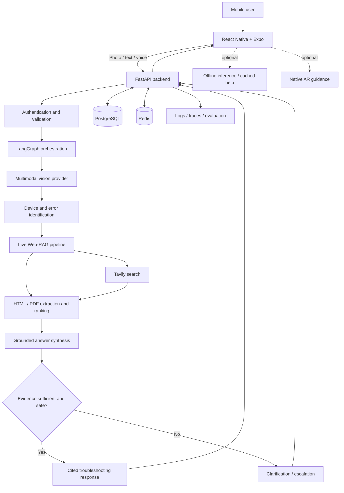

# SnapLens AI

**AI-powered visual troubleshooting assistant | Multimodal Vision · Live Web-RAG · Agentic AI**

> **Project status:** Architecture and development setup. Features below describe the intended system and are not yet implemented.

SnapLens AI is a cross-platform mobile application designed to turn a smartphone camera into an intelligent troubleshooting assistant. Users photograph equipment, appliances, electronics, or visible error codes; the system identifies relevant details, retrieves current technical information, and produces evidence-grounded, step-by-step guidance.

---

## Project Goals

- **Identify** device categories, brands, models, components, labels, and error codes from images.
- **Retrieve** relevant manufacturer manuals, support pages, and other technical references on demand.
- **Generate** cited troubleshooting guidance while communicating uncertainty and safety limitations.
- **Support** follow-up diagnostic conversations and optional hands-free voice interaction.
- **Explore** camera-based AR guidance and limited offline assistance on compatible devices.

---

## Planned Capabilities

| Capability | Description | Status |
| :--- | :--- | :--- |
| **Image-based device identification** | Multimodal analysis of photos and visible labels | Planned |
| **Live Web-RAG** | Search, extract, rank, and ground answers in retrieved sources | Planned |
| **Diagnostic orchestration** | Conditional workflows, clarification questions, and session state | Planned |
| **Mobile client** | Cross-platform camera, results, history, and voice interfaces | Planned |
| **Voice assistance** | Speech input, transcription, and spoken responses | Planned |
| **AR guidance** | Visual annotations where device and platform support allow | Research / planned |
| **Offline fallback** | Limited on-device inference and cached guidance | Research / planned |
| **Observability and evaluation** | Quality, reliability, latency, and cost monitoring | Planned |

---

## System Architecture



> [!CAUTION]
> **Safety Boundary:** The system should not invent model numbers, fabricate citations, or provide speculative instructions for hazardous repairs. High-risk electrical, gas, mechanical, or pressurized work should be escalated appropriately.

---

## Technology Stack and Rationale

| Layer | Selected / Candidate Technology | Why |
| :--- | :--- | :--- |
| **Mobile** | React Native, Expo, TypeScript | Shared iOS/Android codebase and mobile tooling |
| **Camera** | expo-camera | Capture images and camera permissions |
| **Audio** | expo-audio | Modern Expo audio recording/playback APIs |
| **Backend** | Python, FastAPI, Pydantic | Typed APIs and Python AI ecosystem |
| **Vision** | Google Gemini multimodal API | Image and text understanding without training a custom vision model |
| **Agent orchestration** | LangGraph | Stateful, conditional, interruptible diagnostic workflows |
| **Web search** | Tavily | Search results for retrieval-oriented applications |
| **Extraction** | BeautifulSoup4 and PDF parsing tools | Clean HTML and retrieve text from technical manuals |
| **LLM synthesis** | Configurable Gemini / other compatible model | Evidence-grounded answer generation and provider flexibility |
| **Database** | PostgreSQL | Users, sessions, diagnostic history, and source metadata |
| **Cache / transient state** | Redis | Caching, rate limiting, and temporary state where needed |
| **Authentication** | To be finalized | Secure account and session access |
| **API / deployment** | Docker, reverse proxy, cloud hosting | Reproducible deployment and operations |
| **Evaluation** | pytest, integration tests, AI evaluation datasets | Detect regressions and measure groundedness |
| **Monitoring** | Structured logs, OpenTelemetry / tracing | Diagnose latency, failures, and provider costs |
| **AR** | Platform-native AR integration (to be validated) | Camera-space overlays and tracking |
| **Offline AI** | Quantized small model / on-device runtime (to be validated) | Limited assistance without network connectivity |

*Exact model versions, hosting providers, AR compatibility, and on-device runtimes will be pinned after feasibility and device testing.*

---

## End-to-End Workflow

1. **Capture:** The mobile app captures an image and optional question or voice input.
2. **Validate:** The backend checks media type, size, access rights, and request constraints.
3. **Understand:** A multimodal model extracts device identity, visible text, and potential error codes.
4. **Clarify:** If the identity is ambiguous, the user is asked to confirm the model or capture another image.
5. **Retrieve:** The search layer finds relevant official manuals, manufacturer pages, and other sources.
6. **Process:** Retrieved HTML/PDF content is extracted, filtered, ranked, and prepared as evidence.
7. **Reason:** The diagnostic workflow decides whether to search again, ask a question, or generate a response.
8. **Verify:** Generated steps are checked against available evidence and safety constraints.
9. **Respond:** The app displays steps, citations, warnings, and follow-up options.
10. **Persist:** Authorized session history, relevant metadata, and operational telemetry are stored according to retention rules.

---

## Development Phases

| Phase | Scope |
| :---: | :--- |
| **0** | Architecture decisions, repository, development environment, contracts |
| **1** | FastAPI foundation, security, authentication, persistence, media handling |
| **2** | Vision analysis, structured identification, OCR/error-code extraction |
| **3** | Live Web-RAG, manuals/PDF extraction, source ranking, cited synthesis |
| **4** | LangGraph orchestration, diagnostic state, follow-up conversations |
| **5** | React Native mobile application and full backend integration |
| **6** | Voice input/output and real-time interaction |
| **7** | AR overlays and compatible-device tracking |
| **8** | Offline inference and cached guidance |
| **9** | Security hardening, evaluation, deployment, observability, release |

---

## Proposed Repository Layout

```text
snaplens-ai/
├── apps/
│   ├── api/               # FastAPI application and AI services
│   └── mobile/            # React Native / Expo application
├── packages/
│   └── api-client/        # Generated/shared API client and contracts
├── infrastructure/        # Container, CI/CD, and deployment configuration
├── docs/                  # Architecture, diagrams, ADRs, API contracts
├── tests/                 # Cross-service integration and E2E tests
├── .github/workflows/     # Automated checks and deployments
├── .gitignore
└── README.md
```

*This is a proposed structure. Internal AI modules (vision, retrieval, agents, evaluation) will live inside the API app initially and can be extracted only if justified by development needs.*

---

## Local Development

Development instructions will be added once the API and mobile app scaffolds are committed. Planned requirements include Python, Node.js, Git, a mobile test device/emulator, and provider credentials.

> [!IMPORTANT]
> **Environment & Secrets:** Never commit actual `.env` files, private credentials, uploaded user images, or sensitive logs. Each application will provide a sanitized `.env.example` listing required variables without values.

---

## Engineering Principles

- **Evidence-first answers** with traceable citations.
- **Explicit uncertainty** and user confirmation when identification is ambiguous.
- **Safety-aware diagnostic recommendations** and professional escalation for hazardous tasks.
- **Modular interfaces** between API, providers, retrieval, orchestration, and mobile UI.
- **Automated tests**, evaluation cases, observability, and documented architectural decisions.
- **Respect for source-site access restrictions**, copyright, privacy, and user consent.

---

## Documentation

The full architecture blueprint, component interaction diagrams, API contracts, database schema, and operational runbooks will be maintained in [`docs/`](docs/) as they are added to the repository.

---

## Contributing and License

This repository is currently a personal development project. Contribution guidelines and licensing terms will be published separately. No open-source license has been granted by default.
