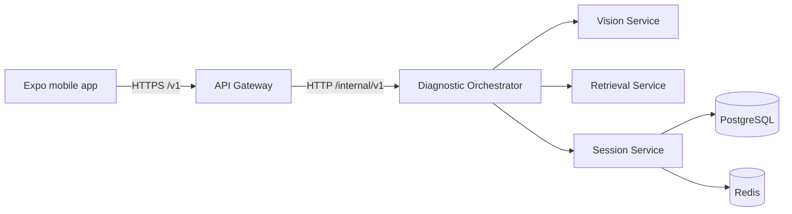

# SnapLens AI service architecture

## First delivery target

SnapLens uses a microservices monorepo. Each service has a separate application,
container, health endpoints, and versioned contract. Docker Compose runs the
services together for local development. Only the API Gateway is public to the
mobile app. The first milestone proves the Gateway-to-Orchestrator path; AI
providers and business workflows are added in later milestones.

## Service ownership

| Service | Owns | Public to mobile? | First milestone |
|---|---|---:|---|
| API Gateway | Client API, request IDs, validation boundary, routing, stable upstream errors | Yes | Diagnosis request route and Orchestrator readiness |
| Diagnostic Orchestrator | Workflow state and calls to specialist services | No | Accepts a diagnosis request; LangGraph comes later |
| Vision Service | Image interpretation and structured identification | No | Multipart analysis endpoint; mock and configurable Gemini providers |
| Retrieval Service | Search, extraction, ranking, and source metadata | No | Health endpoints; Tavily integration later |
| Session Service | Diagnostic session and conversation history | No | Health endpoints; database persistence later |
| PostgreSQL | Durable relational state | No | Local persistent volume |
| Redis | Short-lived state and cache | No | Local persistent volume |

The Gateway contains no diagnosis logic. The Orchestrator owns workflow
decisions. Vision and Retrieval own their provider integrations. The Session
Service is the only service that should write session data. Services access
their own data through their owner rather than querying another service's tables.

## Request flow

1. The mobile app sends a question and image to `POST /v1/diagnoses` on the
   Gateway.
2. The Gateway validates the request, creates or preserves an `X-Request-ID`,
   and forwards the multipart request to the Orchestrator.
3. The Vision Service can be called directly at
   `POST /internal/v1/vision/analyses`; it validates and analyzes the transient
   image using the configured provider.
4. The Orchestrator-to-Vision and Retrieval workflow is not connected yet. The
   Orchestrator currently returns an accepted placeholder, which must not be
   presented as an AI diagnosis.
5. The Gateway returns the accepted response to the client.

All HTTP paths are versioned. Shared Pydantic models live in
`shared/contracts.py`. Internal endpoints use the `/internal/` prefix and are
not published through the Gateway. Errors use a stable envelope with a
machine-readable code and request ID. The Gateway applies an upstream timeout
and does not leak internal exception details.

## Operational boundaries

- Every service exposes `/health/live` and `/health/ready`. Vision readiness
  fails when Gemini is selected without a configured key.
- Gateway readiness also checks the Orchestrator dependency.
- Only the Gateway and the local developer PostgreSQL port are published to the
  host; Redis and internal service ports stay on the Compose network.
- Compose configuration is for local development. Production secrets must come
  from the deployment environment's secret manager.
- Logs and traces should carry the request ID; OpenTelemetry is added in a later
  reliability milestone.
- AI responses must later carry source citations and uncertainty. This scaffold
  does not generate troubleshooting instructions.

## Local run

1. Copy `.env.example` to `.env` and set a local PostgreSQL password.
2. Run `docker compose up --build` from the repository root.
3. Run `python scripts/smoke-compose.py` to check the Gateway and
   Gateway-to-Orchestrator HTTP path.
4. Stop the stack with `docker compose down`. Add `-v` only when you intend to
   remove local database and Redis data.

## Later extraction and scaling

Services are separate containers from the first delivery, but the local stack is
intentionally simple. Add queues for work that needs retries or can finish
asynchronously. Split deployments or data stores when scaling, security, or team
ownership justifies the operational cost.
