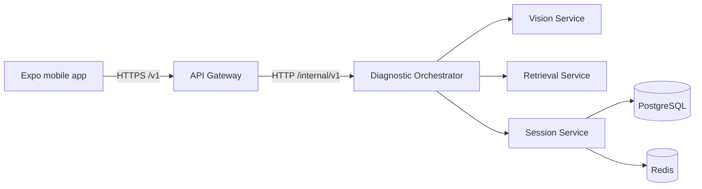

# SnapLens AI service architecture

## First delivery target

SnapLens uses a microservices monorepo. Each service has a separate application,
container, health endpoints, and versioned contract. Docker Compose runs the
services together for local development. Only the API Gateway is public to the
mobile app. The first end-to-end backend flow runs locally without Docker or
provider keys by using mock Vision, Retrieval, and Answer providers.

## Service ownership

| Service | Owns | Public to mobile? | First milestone |
|---|---|---:|---|
| API Gateway | Client API, request IDs, validation boundary, routing, stable upstream errors | Yes | Diagnosis request route and Orchestrator readiness |
| Diagnostic Orchestrator | LangGraph state, service calls, safety, and cited answers | No | Typed image → retrieval → answer workflow |
| Vision Service | Image interpretation and structured identification | No | Multipart analysis; mock and configurable Gemini providers |
| Retrieval Service | Web search, HTML/PDF text extraction, and source metadata | No | Mock and configurable Tavily search; bounded upload extraction |
| Session Service | Diagnostic session and conversation history | No | Health endpoints; database persistence later |
| PostgreSQL | Durable relational state | No | Local persistent volume |
| Redis | Short-lived state and cache | No | Local persistent volume |

The Gateway contains no diagnosis logic. The Orchestrator owns workflow
decisions. Vision and Retrieval own their provider integrations. The Session
Service is the only service that should write session data. Services access
their own data through their owner rather than querying another service's tables.

## Request flow

1. The mobile app sends a question and image to `POST /v1/diagnoses` on the
   Gateway.
2. The Gateway validates the request, creates or preserves an `X-Request-ID`,
   and forwards the multipart request to the Orchestrator.
3. The Orchestrator sends the transient image to Vision and the question plus
   visible device/error details to Retrieval.
4. The Orchestrator synthesizes a response using retrieved evidence, returns
   citations tied to actual source IDs, or asks for clarification.
5. The Gateway returns the `DiagnosisResult` to the client.

Retrieval can extract text from uploaded HTML and PDF bytes through its
internal extraction endpoint. It does not fetch arbitrary URLs, which keeps
the capability separate from SSRF-prone URL fetching.

All HTTP paths are versioned. Shared Pydantic models live in
`shared/contracts.py`. Internal endpoints use the `/internal/` prefix and are
not published through the Gateway. Errors use a stable envelope with a
machine-readable code and request ID. The Gateway applies an upstream timeout
and does not leak internal exception details.

## Operational boundaries

- Every service exposes `/health/live` and `/health/ready`. Provider readiness
  fails when Gemini or Tavily is selected without its configured key.
- Orchestrator readiness checks Vision, Retrieval, and the selected answer
  provider. Gateway readiness checks the Orchestrator.
- Only the Gateway and the local developer PostgreSQL port are published to the
  host; Redis and internal service ports stay on the Compose network.
- Compose configuration is for local development. Production secrets must come
  from the deployment environment's secret manager.
- Logs and traces should carry the request ID; OpenTelemetry is added in a later
  reliability milestone.
- The mock Answer provider never invents repair steps. Gemini synthesis is
  constrained to supplied sources and citations; hazardous repair requests are
  directed to a qualified technician.

## Local run

1. Copy `.env.example` to `.env`; mock providers are the default.
2. Follow the four-service PowerShell workflow in the root README.
3. Optionally run the documented smoke check with Docker Compose when Docker
   is part of the development setup.

## Later extraction and scaling

Services are separate containers from the first delivery, but the local stack is
intentionally simple. Add queues for work that needs retries or can finish
asynchronously. Split deployments or data stores when scaling, security, or team
ownership justifies the operational cost.
